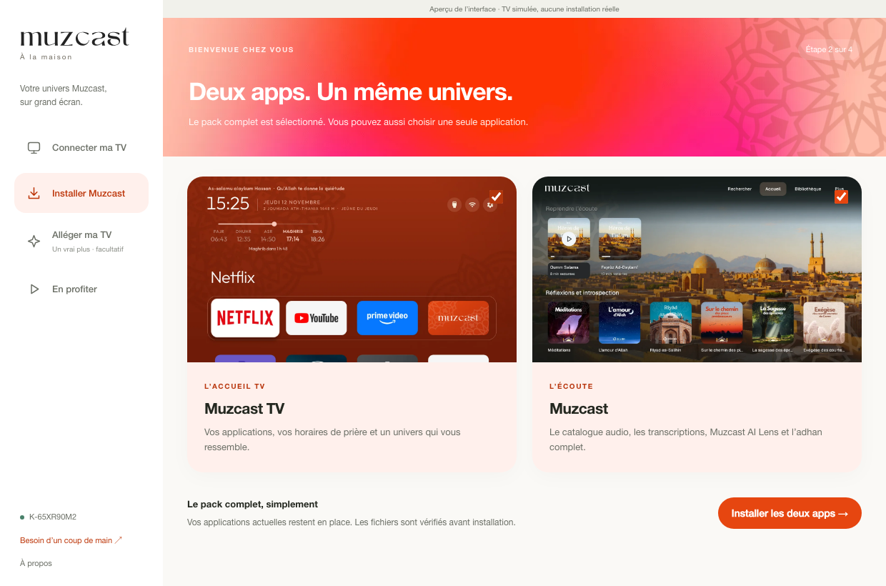
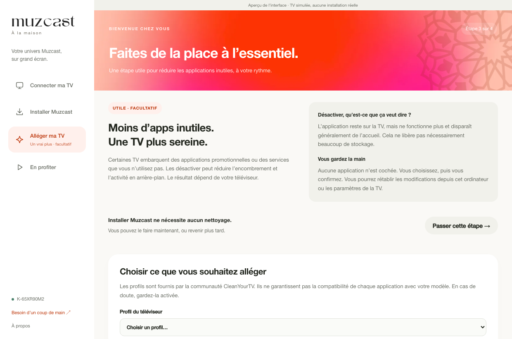

# Muzcast · À la maison

Assistant Mac et Windows pour installer **Muzcast TV** (l’accueil, `com.gathin.tvhome`) et **Muzcast** (l’écoute, `co.muzcast.tv`) sur une TV Android 8+.

Fork de [CleanMyTV](https://github.com/wingedpanther/cleanmytv), sous licence MIT. Le copyright et la licence d’origine sont conservés dans LICENSE. Les profils communautaires proviennent de CleanYourTV, épinglés dans upstream.json.

## Parcours

1. Connexion sur le réseau local, découverte automatique, saisie d’adresse ou association par code.
2. Les deux applications sont sélectionnées par défaut. Téléchargement des versions officielles, vérification SHA-256, package et version de l’APK, installation puis vérification de la version sur la TV. Une installation partielle est conservée ; réessayer poursuit les apps restantes.
3. **Alléger ma TV** : étape importante mais facultative, sans présélection. Choix explicite, récapitulatif, confirmation et restauration. Les fonctions sensibles sont exclues du parcours simplifié. Aucun nettoyage n’est nécessaire à l’installation.
4. Ouverture des apps et explication du choix de l’accueil et de la fermeture du débogage.

Le launcher n’est pas imposé par désactivation de l’accueil constructeur. Les fichiers APK conservent leurs signatures officielles. Les identifiants R2 ne sont jamais embarqués ; le manifeste fournit une URL temporaire. Les téléchargements sont limités aux hôtes officiels, y compris après redirection. Les APK temporaires sont supprimés après utilisation.

## Développement

Node 22.12+ :

```sh
npm ci
npm run sync
npm run typecheck
npm test
npm run dev
```

Dans un navigateur seul, les données sont simulées et un bandeau le précise. Dans Electron, la connexion et les installations sont réelles.

```sh
npm run dist:mac
npm run dist:win
```

Les builds locaux Mac utilisent une signature ad hoc. Une distribution grand public nécessite la signature Developer ID et la notarisation, ainsi que la signature Windows. Aucun test sur TV physique n’est revendiqué pour cette première version.

## Sources officielles

- Launcher : https://www.muzcast.co/tv/update.json
- App : https://www.muzcast.co/api/tv-updates
- Guide : https://tv.muzcast.co

Les modules upstream avancés sont conservés pour faciliter les mises à jour du fork, mais ne sont pas exposés par l’interface simplifiée. Leurs textes internes de diagnostic restent parfois en anglais.

## Vérification du paquet natif

La version 0.1.1 corrige le crash avant affichage observé sur macOS 27 : noms internes ASCII cohérents pour le bundle, l’exécutable et les helpers Electron, avec nom français conservé dans CFBundleDisplayName. Les crédits sont dans À propos. La DA reprend les couleurs et le splash Corail de l’app Muzcast.

Après compilation : `node scripts/smoke-packaged.mjs "dist/mac-arm64/MuzcastSetup.app/Contents/MacOS/MuzcastSetup"`. Le test ouvre le vrai paquet, contrôle le bridge natif, À propos et la saisie manuelle. Il ne connecte ni ne modifie aucune TV.

## Aperçu





Captures de l’interface avec une TV simulée. La validation réelle du téléchargement des deux APK est disponible via `npx tsx scripts/verify-muzcast-releases.ts` ; elle ne modifie aucune TV.

## Compilation automatisée

`docs/muzcast/build-workflow.yml` contient le workflow adapté à Muzcast (sans recompiler le launcher de CleanMyTV). Le copier vers `.github/workflows/build.yml` avec un accès GitHub autorisé à modifier les workflows avant d’activer Actions. Le workflow upstream n’est pas utilisé pour distribuer cette version.
